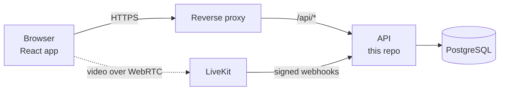

# Xovê API

The API of [Xovê](https://xove.app): a private room where invited friends share their screens and cameras and watch each other live, up to 6 streams at once, 20 people in the room, with a queue when it's full. This repo is the server side; the web app is in [`xove`](https://github.com/Hbrauveres/xove).

## What it does

- **Who gets in:** Google sign-in, access requests, and an admin who approves them. Sessions live in the database, so removing a member ends their sessions at once.
- **The room:** 20 seats, sharers included, with a queue and a seat offered in turn when one frees up.
- **The streams:** up to 6 live screens and cameras, their quality and mode, and who's watching what.
- **LiveKit:** signs the tokens that let a seated member join the video room, and follows the room through LiveKit's signed webhooks. The video itself never goes through the API.

## How it's built

| Part | Tech |
| --- | --- |
| Code | Java 21, Spring Boot 4 (Web MVC, Security, Data JPA, Actuator), Maven |
| Data | PostgreSQL 17, schema by Flyway, server-side sessions (Spring Session JDBC) |
| Video | Tokens and webhooks for a self-hosted [LiveKit](https://livekit.io) server (a WebRTC SFU) |
| Delivery | GitHub Actions: on every push, build the image, start it with a database and check it's healthy, JUnit with Testcontainers, Trivy and Semgrep; on every merge, publish it and deploy it to staging, where a new version starts next to the serving one and takes over only once it's healthy; a version tag releases it to production, with a rollback button |



More in [docs/architecture.md](docs/architecture.md), and every endpoint in [docs/api.md](docs/api.md).

This repo was split out of `xove` with its history: a commit's `(Hbrauveres/xove#n)` is that repo's pull request.

## Run it and test it

```bash
./mvnw spring-boot:run          # the API (needs its settings, see Getting started)
docker compose -f compose.yaml -f compose.local.yaml up   # with a throwaway database
./mvnw test                     # JUnit, MockMvc, Testcontainers (needs Docker)
```

Details in [Getting started](docs/getting-started.md) and [Testing](docs/testing.md).

## How changes are made

Every change starts as a written spec with numbered requirements and acceptance criteria, then a plan and small tasks; the pull request proves each criterion with tests, and the checks run on every commit. See [CONTRIBUTING.md](CONTRIBUTING.md). The specs, decisions and operations notes are kept in a private workspace; the history and the pull requests here show the result.
