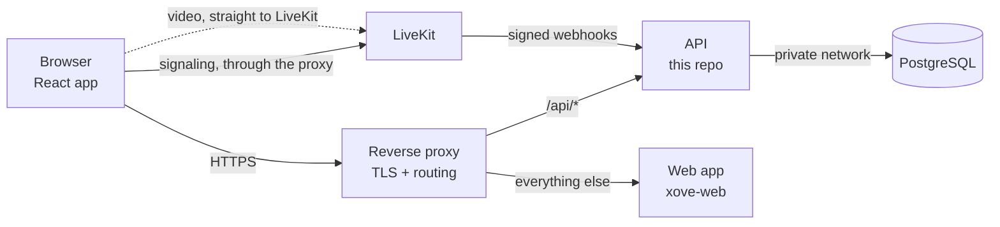
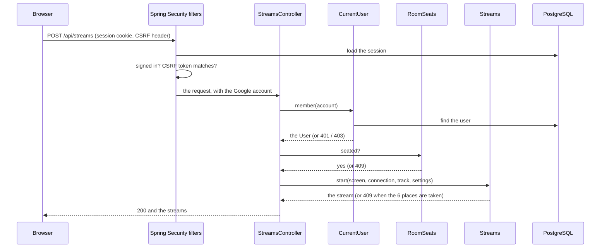
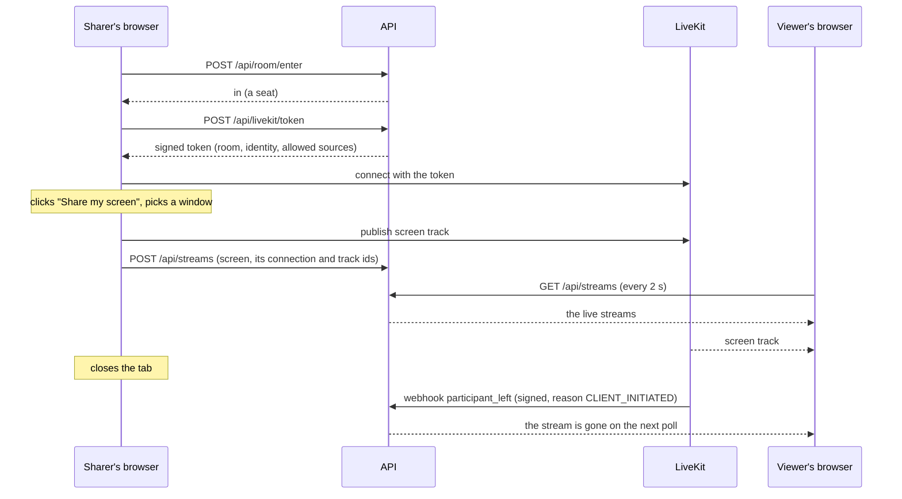

# Architecture

How the API is built: its place in Xovê, its modules, the path of a request, the room's seats and streams, LiveKit, and what lives in memory or in the database. The endpoints are in [API](api.md), the tables in [Data model](data-model.md), the protections in [Security](security.md).

## Components



| Component | What it does | Tech |
| --- | --- | --- |
| **API** (this repo) | Sign-in, sessions, access requests, admin actions, the room's seats and live streams, LiveKit tokens and webhooks | Java 21, Spring Boot 4 (Web MVC, Security, Data JPA, Actuator), Maven |
| **Web app** ([`xove-web`](https://github.com/Hbrauveres/xove-web)) | The single-page app the browser runs | React, TypeScript |
| **PostgreSQL** | Users, access requests, sessions | PostgreSQL 17; the schema is the API's ([Data model](data-model.md)), applied by Flyway when it starts |
| **LiveKit** | Receives each screen and camera once and forwards it to every viewer | A self-hosted [LiveKit](https://livekit.io) server (a WebRTC SFU), one per environment |
| **Reverse proxy** | HTTPS certificates; sends `/api/*` to the API and everything else to the web app | Caddy |

The database is reachable only by the API, on a private network; only the proxy and LiveKit's media ports face the internet.

**Released on its own.** The API and the web app each have their own repo, image, version and rollback: deploying one never restarts the other. So they can run at different versions, and the API changes first: it stays compatible with the web app that's live, and a web release that needs something new is made only once that API is live. On a server, a new version starts next to the one serving, and takes over only once it's healthy, so a deploy fails no request.

**Signaling vs media.** Joining the video room, knowing who's there and which tracks exist happens over a WebSocket through the proxy. The video itself goes straight to LiveKit (UDP, with a TCP fallback). The API never touches media: it decides who may join, and LiveKit tells it what happened.

## Modules

One package per part of the domain, under `dev.hbrauveres.xove`. Each holds its controller, its logic and its data, so a change usually stays inside one package.

| Package | Owns | Main classes |
| --- | --- | --- |
| `auth` | What happens after Google confirms who you are, `/api/me`, turning the signed-in account into a `User` | `LoginSuccessHandler`, `AdminAuthoritiesMapper`, `CurrentUser`, `MeController` |
| `user` | Users and their status (`NONE`, `PENDING`, `MEMBER`, `DECLINED`) | `User`, `UserRepository`, `UserService` |
| `access` | Every rule about who gets in: requesting, approving, declining, removing | `AccessService`, `AccessRequestController`, `AccessRequest` |
| `admin` | The admin endpoints, on top of `access` | `AdminController` |
| `room` | The seats and the queue | `RoomSeats` (plain Java), `RoomController` |
| `stream` | The live streams, their settings, and who watches what | `Streams`, `Watching` (plain Java), `StreamsController` |
| `livekit` | Tokens to join the video room, and LiveKit's webhooks | `LiveKitTokens`, `LiveKitController`, `LiveKitWebhookVerifier`, `LiveKitWebhookController` |
| `config` | Security and the app's settings | `SecurityConfig`, `XoveProperties` |

**The rules are plain Java.** `RoomSeats`, `Streams` and `Watching` know nothing about Spring, HTTP or the database: the controllers translate requests into calls on them, and their `*Config` class creates one of each, with the system clock (UTC). Tests create them with a clock of their own and move time instead of waiting ([Testing](testing.md)).

## A request's path

`POST /api/streams`, a member starting to share their screen:



1. **The filters** load the session from PostgreSQL, refuse anyone not signed in (401) and any state-changing request without the CSRF token (403). `/api/admin/**` also needs the admin role. Details in [Security](security.md).
2. **The controller** turns the signed-in Google account into the user (`CurrentUser.member`: 403 for someone who isn't a member) and checks the rule that spans modules (here: only someone with a seat may share).
3. **The logic** (`Streams`) applies the domain's rules and answers, or throws an exception the controller turns into a status.
4. **Errors** come back as [RFC 9457](https://www.rfc-editor.org/rfc/rfc9457) problem details; their `detail` is the message the web app shows.

Only signing in, the user and access requests touch the database during a request; the room's state never does.

## The room: seats, the queue and streams

The API owns **who** is in the room and **which streams** are live (spec 0060). LiveKit carries the video.



### Seats and the queue

- **20 seats,** sharers included. The number is a setting, `XOVE_ROOM_SEATS` (1 to 20, 20 when not set); a test environment can use fewer to try the queue.
- **Only someone with a seat gets a LiveKit token,** so the room can't go past the seats.
- **Entering:** the room page asks for a seat (`POST /api/room/enter`). With one free and nobody waiting, you're in. Otherwise the waiting screen shows your place, and asks again every 2 seconds (that poll is how the API knows you're still there).
- **A free seat is offered** to the first in the queue: a popup with "Enter room" and "Cancel", and 60 seconds to answer (the tab's title says "Your turn"). The seat is held for them meanwhile. "Cancel" leaves the queue; no answer moves them to the end, and the next person gets the popup.
- **Leaving keeps your place for a while:**

  | You were | How you left | How the API knows | Kept for |
  | --- | --- | --- | --- |
  | In the room | closed the tab | LiveKit's `participant_left`, reason `CLIENT_INITIATED` | 30 s |
  | In the room | connection dropped | `participant_left`, any other reason | 60 s |
  | In the queue | closed the tab | `POST /api/room/leave`, sent with `keepalive` while the page closes | 30 s |
  | In the queue | connection dropped | no poll | 90 s after the last poll: Chrome lets a tab in the background poll only about once a minute |

  A dropped connection takes longer in total: LiveKit first waits for the browser to come back (about 20 to 30 seconds), and only then reports the leave.
- **A seat never used** (a token handed out, nobody joined LiveKit) is given up after 60 seconds.
- Nothing runs on a timer: whatever has run out is tidied away each time someone asks, by the clock.

### Streams

1. **Up to 6 live streams,** each a person's screen or camera. Someone with both uses 2. Nobody is pushed out: with 6 live, the start buttons wait.
2. **Stop:** the lit button, the menu's Stop, or the browser's own bar stops the video and ends the stream. Only its person can stop or change a stream.
3. **Reload while sharing:** the page sees the API lists a stream of its own that nothing sends, and ends it.
4. **Everyone** polls the streams every 2 seconds and plays them from LiveKit. People sharing see their own streams, as viewers do, without their sound.
5. **A sharer leaves** (closes the tab, loses connection, crashes): LiveKit sends the API a signed webhook, and the API ends all of that person's streams at once, so nobody watches a frozen picture; their seat is kept as above. A stopped track ends just that stream. Only one connection per person: opening the room on a second device disconnects the first. Specs: `0038`, `0060`.
6. **Settings:** each stream is sent with a quality and a mode (Smooth or Sharp). The sharer's browser changes them live and tells the API (`POST /api/streams/{kind}/settings`); every viewer reads them with the streams.

**Who watches what:** each browser reports what's on its stage (`PUT /api/streams/watching`), once it has been still for a second, and again when a poll shows the API lost it. The streams poll returns everyone's, for the people panel.

Where this state lives, and what a restart does to it: [Memory and the database](#memory-and-the-database).

## LiveKit

**Tokens.** A member with a seat asks for a token (`POST /api/livekit/token`); the API signs it with the key pair it shares with LiveKit, and the browser connects to LiveKit with it. What a token allows is in [Security](security.md#livekit-tokens).

**Webhooks.** LiveKit posts every room event to the API, signed with the same key pair. The API refuses anything whose signature doesn't check out, ignores events from any room but its own (`LIVEKIT_ROOM`), and acts on three:

| Event | What the API does |
| --- | --- |
| `participant_joined` | The seat is used (`RoomSeats.joined`) |
| `participant_left` | That connection's streams end (`Streams.connectionLeft`); the seat is kept 30 s when the tab was closed (`CLIENT_INITIATED`), 60 s for anything else (`RoomSeats.left`); what they watched is forgotten |
| `track_unpublished` | That screen or camera ends (`Streams.trackUnpublished`) |

Each environment has its own LiveKit server, key pair and room, so nothing signed for one is accepted by another. The API only needs `LIVEKIT_URL`, the key pair and `LIVEKIT_ROOM` ([Getting started](getting-started.md#environment-variables)).

## Memory and the database

| Where | What | Why there |
| --- | --- | --- |
| **PostgreSQL** | Users and their status, access requests, sessions | It must survive restarts and deploys: who's a member, who's signed in |
| **The API's memory** | Seats and the queue (`RoomSeats`), live streams (`Streams`), who watches what (`Watching`) | It changes every second, means something only while people are connected, and there is one API instance for a handful of people: nothing worth writing down |

**What a restart loses.** A new version of the API (every API deploy, never a web deploy) starts with an empty room. The open pages bring it back on their own:
- each room page asks for its seat again within a poll, sending its LiveKit connection: LiveKit doesn't report that connection joining again, so this confirms the seat;
- each page still sending a screen or camera registers it again; re-registered streams count as started then, so "longest sharing" restarts from that order. If the 6 places filled up meanwhile, the page stops sending; any other failure is tried again on the next poll;
- what people watch is reported again within a second.

Sessions are in the database, so nobody is signed out.

**Nothing runs on a timer.** Whatever has run out (a kept seat, an unanswered offer, a waiting page that stopped polling) is tidied away each time someone asks, by the clock. The logic is `synchronized` per object: one API instance, so no locks across machines.

**Running two copies.** During a deploy the new version starts next to the old one, each with its own memory; the old one keeps serving until the new one is healthy, then the room moves over as above.

## Repository layout

Split out of the original `xove` repo with its history: a commit's `(Hbrauveres/xove#n)` is that repo's pull request (the web app's repo is now [`xove-web`](https://github.com/Hbrauveres/xove-web)).

```
src/main/java/dev/hbrauveres/xove/   one package per module (above)
src/main/resources/application.yml   settings, read from environment variables
src/main/resources/db/migration/     Flyway migrations (Data model)
src/test/java/…                      the tests (Testing)
Dockerfile          the image: built with Maven, run on a JRE as a non-root user
compose.yaml        the API on its own, as servers deploy it
compose.local.yaml  adds a throwaway database, locally and in the checks
.github/workflows/  the commit checks (ci.yml), the stage release (stage.yml),
                    the production release (release.yml), and the deploy both call (deploy.yml)
```

## Data model and security

- The tables, their relations and how a migration stays compatible: [Data model](data-model.md).
- Sign-in, sessions, CSRF, admins, LiveKit tokens and webhooks, and the known trust boundaries: [Security](security.md).
