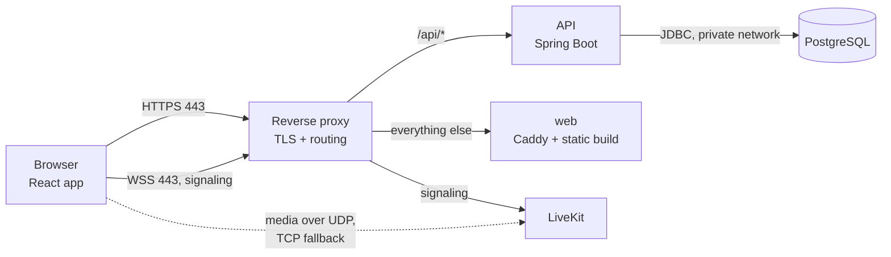
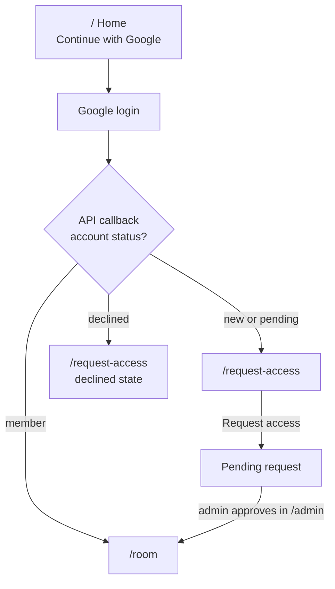
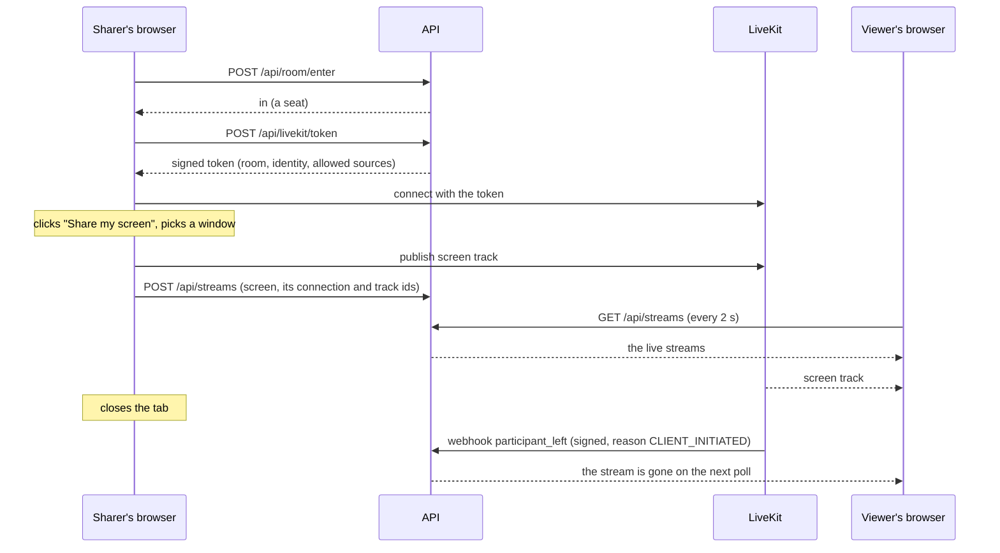

# Architecture

How the API is built: its place in Xovê, how people get in, the room's seats and streams, LiveKit, the data and the security model. The endpoints are in [API](api.md).

## Components



| Component | What it does | Tech |
| --- | --- | --- |
| **web** | The single-page app: home, request access, room, admin | React 19, TypeScript, Vite, React Router, CSS modules, `livekit-client`; served by Caddy built from source on the latest Go, running as a non-root user |
| **api** | Login, sessions, access requests, admin actions, the room's seats and live streams, LiveKit tokens | Java 21, Spring Boot 4 (Web MVC, Security, Data JPA, Actuator), Maven |
| **db** | Users, access requests, sessions | PostgreSQL 17. The schema is the app's (Flyway, run by the API on start); the server runs outside this repo: on servers from the private `xove-ops` repo, one per environment; locally and in CI from `compose.local.yaml` |
| **livekit** | Receives each screen and camera once and forwards it to every viewer | LiveKit server (a WebRTC SFU), one per environment, run from the `xove-ops` repo; each environment has its own room (staging `xove-stage`, production `xove`) |
| **reverse proxy** | HTTPS certificates, routing by hostname and path | Caddy, shared by every app on the server; configured in a separate private repository |

The database is only reachable by the API, on a private Docker network per environment (`xove-<env>-db`), and the API knows it only by `POSTGRES_HOST`. Only the proxy and LiveKit's media ports face the internet.

**Two apps, deployed on their own.** The web app and the API each have their own repo, compose file (here `compose.yaml`), version and rollback: deploying one never restarts the other, so a web-only change keeps the room's live state. The web app gets only `APP_ENV`, none of the API's settings. The API deploys first, so the web app never runs against an older API than it was built for. Their container names (`xove-<env>-web`, `xove-<env>-api`) are what the proxy and LiveKit reach them by. On servers each app runs as two copies, and only the serving one answers to that name: a new version starts next to it and takes the name once it's healthy, so a deploy fails no request.

**Signaling vs media.** Joining the room, knowing who's there and which tracks exist happens over a WebSocket that goes through the proxy. The video itself travels over UDP straight to LiveKit (with a TCP fallback for networks that block UDP). The API never touches media.

## Repository layout

The API's code is here; the web app lives in [`xove`](https://github.com/Hbrauveres/xove) (to be renamed `xove-web`). Both came from `xove`, and this repo keeps the API's history from there: a commit's `(Hbrauveres/xove#n)` is that repo's pull request.

```
src/main/java/dev/hbrauveres/xove/
  access/           access requests and member management
  admin/            admin endpoints
  auth/             login success handling, /api/me, the current user
  config/           security and application settings
  livekit/          LiveKit token issuing
  room/             the room's seats and the queue
  stream/           the live streams (screens and cameras)
  user/             users
src/main/resources/db/migration/   Flyway migrations (V1, V2, …)
src/test/java/…                    the tests (Testing)
Dockerfile          the image: built with Maven, run on a JRE as a non-root user
compose.yaml        the API on its own, as servers deploy it: its service and the networks it joins
compose.local.yaml  adds a throwaway database, locally and in the checks
.github/workflows/  the commit checks (ci.yml)
```

## Who gets in



| Route | Who sees it | What it shows |
| --- | --- | --- |
| `/` | Signed out | What Xovê is, "Continue with Google" |
| `/request-access` | Signed in, not a member | "You need access", optional message, request button; a pending state that checks every 20 s and moves you in when approved; a declined state that allows asking again |
| `/room` | Members | Stage (with my screen and camera buttons), people, activity feed |
| `/admin` | Admins | Pending requests (approve, decline), members (remove) |

On a phone or tablet (touch first) in a browser tab, every route shows the install screen instead (spec 0171): Xovê is used from the home screen there, so sign-in happens inside the app.

Every sign-in gets a session, even for non-members; it just can't reach member-only endpoints.


## The room: seats, the queue and streams

The API owns **who** is in the room and **which streams** are live (spec 0060). LiveKit carries the video.



### Seats and the queue

- **20 seats,** sharers included. The number is a setting, `XOVE_ROOM_SEATS` (1 to 20, 20 when not set); staging uses 3 to try the queue.
- **Only someone with a seat gets a LiveKit token,** so the room can't go past the seats.
- **Entering:** the room page asks for a seat (`POST /api/room/enter`). With one free and nobody waiting, you're in. Otherwise the waiting screen shows your place, and asks again every 2 seconds (that poll is how the API knows you're still there).
- **A free seat is offered** to the first in the queue: a popup with "Enter room" and "Cancel", and 60 seconds to answer (the tab's title says "Your turn"). The seat is held for them meanwhile. "Cancel" leaves the queue; no answer moves them to the end, and the next person gets the popup.
- **Leaving keeps your place for a while:**

  | You were | How you left | How the API knows | Kept for |
  | --- | --- | --- | --- |
  | In the room | closed the tab | LiveKit's `participant_left`, reason `CLIENT_INITIATED` | 30 s |
  | In the room | connection dropped | `participant_left`, any other reason | 60 s |
  | In the queue | closed the tab | `POST /api/room/leave`, sent with `keepalive` while the page closes | 30 s |
  | In the queue | connection dropped | no poll | 90 s after the last poll: Chrome lets a tab in the background poll only about once a minute |

  A dropped connection takes longer in total: LiveKit first waits for the browser to come back (about 20 to 30 seconds), and only then reports the leave.
- **A seat never used** (a token handed out, nobody joined LiveKit) is given up after 60 seconds.
- Nothing runs on a timer: whatever has run out is tidied away each time someone asks, by the clock.

### Streams

1. **Up to 6 live streams,** each a person's screen or camera. Someone with both uses 2. Nobody is pushed out: with 6 live, the start buttons wait.
2. **Stop:** the lit button, the menu's Stop, or the browser's own bar stops the video and ends the stream. Only its person can stop or change a stream.
3. **Reload while sharing:** the page sees the API lists a stream of its own that nothing sends, and ends it.
4. **Everyone** polls the streams every 2 seconds and plays them from LiveKit. People sharing see their own streams, as viewers do, without their sound.
5. **A sharer leaves** (closes the tab, loses connection, crashes): LiveKit sends the API a signed webhook, and the API ends all of that person's streams at once, so nobody watches a frozen picture; their seat is kept as above. A stopped track ends just that stream. Only one connection per person: opening the room on a second device disconnects the first. Specs: `0038`, `0060`.
6. **Settings:** each stream is sent with a quality and a mode (Smooth or Sharp). The sharer's browser changes them live and tells the API (`POST /api/streams/{kind}/settings`); every viewer reads them with the streams.

**Who watches what:** each browser reports what's on its stage (`PUT /api/streams/watching`), once it has been still for a second, and again when a poll shows the API lost it. The streams poll returns everyone's, for the people panel.

Seats and streams live in the API's memory: one API instance, a handful of people, nothing worth persisting. A restart (every deploy of the API, not of the web app) empties them; each open room asks for its seat again within a poll, with its LiveKit connection (LiveKit doesn't report it joining again, so that confirms the seat), and registers what it's still sending. If the 6 places filled up meanwhile, it stops sending; any other failure is tried again on the next poll. Re-registered streams count as started then, so "longest sharing" restarts from that order.

## LiveKit

**LiveKit webhooks.** Each environment's LiveKit posts every room event to its own API (`http://xove-<env>-api:8080/api/livekit/webhook`), signed with that environment's API key (a JWT with a hash of the body). The API refuses anything whose signature doesn't check out, ignores events from any room other than its own, and only acts on `participant_joined` (the seat is used), `participant_left` (the person's streams end, the seat is kept 30 or 60 seconds by its `disconnectReason`) and `track_unpublished` (a screen or camera ends).

**Where LiveKit runs** (spec 0044). One LiveKit server per environment, both defined once in the `xove-ops` repo (`livekit/compose.yaml`) and fed by that environment's generated settings: staging at `rtc-stage.xove.app` with media on 7881/tcp and 7882/udp, production at `rtc.xove.app` with 7883/tcp and 7884/udp. Each has its own key pair, shared only with its own API, so nothing signed for one environment is accepted by the other. This app only needs `LIVEKIT_URL`, the key pair and `LIVEKIT_ROOM`.

## Data model

| Table | Columns |
| --- | --- |
| `users` | id, email (unique, lowercase), name, avatar_url, google_subject (unique), status (`NONE`, `PENDING`, `MEMBER`, `DECLINED`), created_at |
| `access_requests` | id, user_id, message (≤ 500 characters), status (`PENDING`, `APPROVED`, `DECLINED`), created_at, decided_at, decided_by; at most one pending request per user |
| `spring_session`, `spring_session_attributes` | Server-side sessions (Spring Session JDBC) |

Every schema change is a new Flyway migration. A migration that already ran is never edited.

## Security model

- **Authentication:** Google sign-in through Spring Security (state, PKCE and session fixation handled by the framework). Accounts whose Google email isn't verified are turned away.
- **Sessions:** stored server-side in PostgreSQL, so removing a member can end their sessions immediately. The cookie is `HttpOnly`, `Secure` and `SameSite=Lax`.
- **CSRF:** every state-changing request carries a token read from a cookie and echoed in a header.
- **Authorization:** member and admin checks happen on the server for every request. The API never trusts an id sent by the browser.
- **LiveKit tokens:** signed by the API with a secret LiveKit shares. A token names one room and one identity, allows publishing only a screen, its sound and a camera (never a microphone), and expires after one hour. Only someone with a seat gets one. The secret never reaches the browser.
- **Network:** the database has no public port. The app's containers publish no ports; only the proxy (80/443) and each LiveKit's two media ports face the internet.
- **Supply chain:** every change passes a vulnerability scan of the images and dependencies and a static analysis of the code before it can be published (the commit checks in `.github/workflows/ci.yml`).

**Trust boundaries to know about:** any seated member's token may publish a screen and a camera; the 6-stream limit is enforced by the web app and the API's list, not by LiveKit. And a token stays valid for an hour, so someone who lost their seat could rejoin LiveKit with an old one. And after a restart the API takes a page's word for its LiveKit connection when it asks for its seat again, so a member could keep a seat they don't use. All three are acceptable for a small group of friends.
