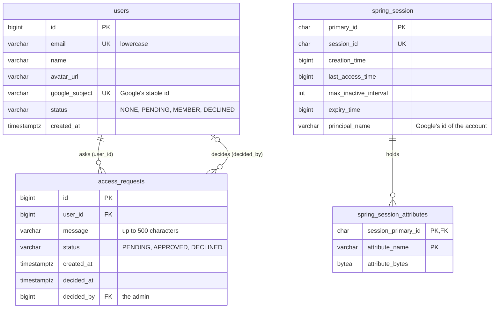

# Data model

What the API keeps in PostgreSQL, how the tables relate, and how the schema changes without breaking the version that's running. What the API keeps in memory instead is in [Architecture](architecture.md#memory-and-the-database).

## The tables

| Table | Holds | From |
| --- | --- | --- |
| `users` | Everyone who ever signed in, and their status: `NONE` (signed in, never asked), `PENDING`, `MEMBER`, `DECLINED` | `V1`, `google_subject` in `V2` |
| `access_requests` | Each request to get in, with its optional message and who decided it, when | `V1` |
| `spring_session`, `spring_session_attributes` | Server-side sessions, in [Spring Session JDBC](https://docs.spring.io/spring-session/reference/)'s official schema | `V2` |

**Why `google_subject`.** People sign in with Google, and an email can change; Google's `sub` can't. The user is found by `google_subject` first, and by email only for an account created before `V2` (`UserService.recordGoogleLogin`), which then gets its `google_subject` linked.

**Why sessions in the database.** Removing a member deletes their sessions by `principal_name`, so they're signed out everywhere at once ([Security](security.md#sessions)). A restart or a deploy signs nobody out.

## What the database guarantees itself

The code checks these too, but the database is the last word, even with two requests at the same moment:

| Rule | How |
| --- | --- |
| One account per email | `users.email` is `unique`; emails are stored lowercase (`User.normalizeEmail`) |
| One account per Google account | `users.google_subject` is `unique` |
| **At most one pending request per user** | A partial unique index: `one_pending_request_per_user on access_requests (user_id) where status = 'PENDING'`. Declined or approved requests don't count, so a declined person can ask again |
| Only known statuses | `check (status in (…))` on both tables |
| A user's requests go with them | `access_requests.user_id … on delete cascade` |

`PersistenceTest` checks the email rules and the pending-request index against a real PostgreSQL: lowercase emails, duplicates refused, a second pending request refused, a new one allowed after a decline ([Testing](testing.md#persistence-tests)).

## Migrations

The schema is created and changed only by [Flyway](https://documentation.red-gate.com/flyway) migrations, in `src/main/resources/db/migration/`, applied in order (`V1__…`, `V2__…`) when the API starts. Hibernate only checks that the entities match the tables (`ddl-auto: validate`); it never changes them.

**Two rules:**

1. **A migration that already ran is never edited.** Flyway records a checksum of each one it applied, and refuses to start if a file changed. A fix is a new migration.
2. **A new migration works with the previous version of the code.** A rollback puts the old code back but leaves the database as the new version left it, and during a deploy the old and new versions run side by side for a moment against the same database. So a migration only adds: a new table, a nullable column or one with a default, an index. Anything that would break the old code is split over several releases.

**Example: renaming `users.name` to `display_name`.** Done in one migration, the old code would fail the moment it ran (`ddl-auto: validate` finds no `name`). Instead:

| Release | Migration | Code |
| --- | --- | --- |
| 1 | `V3`: add `display_name`, copy `name` into it | Writes both columns, reads `display_name` |
| 2 | none | Writes and reads only `display_name`; the entity no longer maps `name` |
| 3 | `V4`: drop `name` | — |

After each release, the previous one still works against the database, so any one of them can be rolled back. This is often called *expand and contract*.
