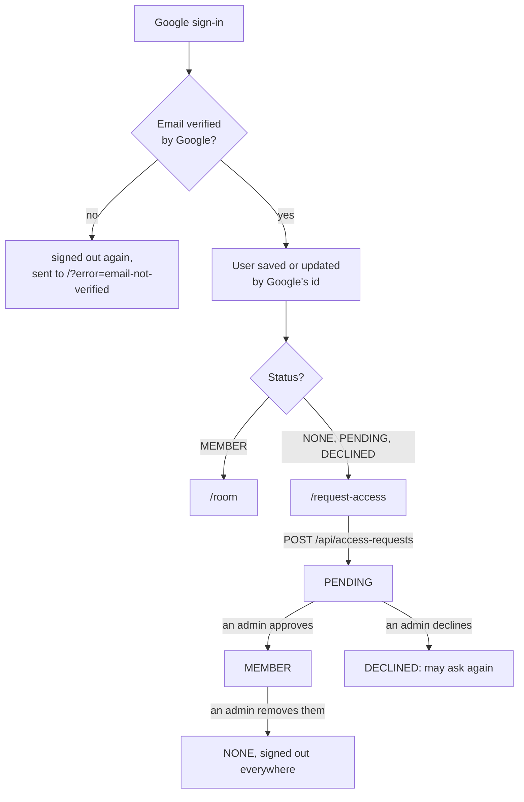

# Security

How the API decides who gets in and what they may do, and what it trusts. Each part names the code that does it and the test that proves it. The rules in one place are in `config/SecurityConfig.java`.

## Who gets in

Xovê is invite-only: anyone with a Google account can sign in and ask, but only members reach the room.

## Signing in with Google

- **OpenID Connect through Spring Security** (`oauth2Login`): the `state` parameter, PKCE and a new session id after sign-in come from the framework. Every URL is under `/api` (`/api/oauth2/authorization/google`, `/api/login/oauth2/code/google`), so the proxy sends them to the API. Proven by `AuthTest.loginStartsAtGoogleWithOurCallback`.
- **Only verified emails.** An account whose email Google hasn't verified is signed out again and sent back (`LoginSuccessHandler`). `LoginSuccessHandlerTest.unverifiedEmailsAreTurnedAway`.
- **A person is Google's id, not their email.** The user is found by Google's `sub` (`google_subject`), which never changes; signing in again updates the same user. `AuthTest.repeatedLoginsUpdateTheSameUser`.
- After sign-in, members go to `/room` and everyone else to `/request-access`. `LoginSuccessHandlerTest.membersGoToTheRoom`, `nonMembersGoToRequestAccess`.

## Sessions

- **Kept in PostgreSQL** (Spring Session JDBC), so they survive restarts and can be ended from the server. The browser holds only an id.
- **The cookie** `XOVE_SESSION` is `HttpOnly` (scripts can't read it), `Secure` (HTTPS only) and `SameSite=Lax` (not sent on requests started by other sites, except plain navigation). A session lasts 30 days without use (`application.yml`).
- **Logging out** (`POST /api/auth/logout`) ends the session and answers 204; it needs the CSRF token like any change. `AuthTest.logoutRequiresCsrfToken`.
- **Removing a member** sets them back to `NONE` and deletes every session of theirs, so they're signed out on every device at once (`AccessService.removeMember`). `AccessFlowTest.removingAMemberRevokesAccessAndSignsThemOut`.
- **An API answers 401**, it never redirects to a login page: the web app decides what to show. `AuthTest.meRequiresLogin`.

## CSRF

A forged request from another site would carry the session cookie, so every request that changes something must also prove it comes from Xovê's own page:

- the API sets a readable `XSRF-TOKEN` cookie (on `GET /api/me`, among others); `CsrfCookieTest.meSetsTheXsrfCookieForTheFrontend`;
- the web app copies it into an `X-XSRF-TOKEN` header on every `POST`, `PUT` and `DELETE`; another site can't read the cookie, so it can't send the header;
- without it the API answers 403. `AccessFlowTest.requestingAccessNeedsCsrfToken`, `LiveKitControllerTest.withoutTheCsrfTokenItIsRejected`.

This is Spring Security's setup for single-page apps (`csrf.spa()`). The one exception is LiveKit's webhook, which has no session and proves itself with its signature ([below](#livekit-webhooks)).

## Access requests and admins

- **Asking:** a signed-in user who isn't a member sends a request with an optional message of up to 500 characters; asking again while one waits is refused (409), and so is a member asking (409). `AccessFlowTest.aNewUserCanRequestAccess`, `aSecondRequestWhileWaitingIsRejected`, `membersCannotRequestAccess`, `messagesOver500CharactersAreRejected`. The database also allows only one pending request per user ([Data model](data-model.md#what-the-database-guarantees-itself)).
- **Admins are a setting,** `ADMIN_EMAILS` (comma-separated). At sign-in, a verified email on that list gets the `ADMIN` role (`AdminAuthoritiesMapper`) and is always a member. `AdminAuthoritiesMapperTest.adminEmailsGetTheAdminRole`, `unverifiedEmailsNeverGetAdmin`; `AuthTest.adminEmailsBecomeMembers`.
- **Admin endpoints** (`/api/admin/**`) need that role, checked by the security config, and `AccessService` checks it again for each action. `AccessFlowTest.adminEndpointsNeedLogin`, `adminEndpointsRejectNonAdmins`.
- **Deciding:** approving makes the user a member; declining keeps them out but lets them ask again; a request is decided once (409 after). `AccessFlowTest.approvingMakesTheUserAMember`, `decliningKeepsTheUserOutButLetsThemAskAgain`, `aRequestCanOnlyBeDecidedOnce`.
- **Admins can't be removed** from the admin page: they're taken out of `ADMIN_EMAILS`. `AccessFlowTest.adminsCannotBeRemoved`.

## Members only, checked on every request

Every member endpoint turns the signed-in account into the user on the server (`CurrentUser.member`) and answers 403 to anyone who isn't a member. The API never takes a user id from the browser: "me" is always the session's user, and only a stream's own person can change or stop it. `LiveKitControllerTest.nonMembersGet403`.

## LiveKit tokens

To join the video room, a browser needs a token the API signs (`LiveKitTokens`), a JWT signed with the secret the API shares with LiveKit (`HS256`). LiveKit checks the signature and the grants, and refuses anything else.

| The token says | So |
| --- | --- |
| Issued by the API's key, for identity `user-<id>`, with the person's name | LiveKit knows who it is; the same identity on another device replaces the first connection |
| One room only, this environment's (`LIVEKIT_ROOM`) | It can't join any other room |
| May publish only `screen_share`, `screen_share_audio` and `camera` | Never a microphone; no data messages, no changing its own metadata |
| Valid from now for 1 hour | An old token stops working |

`LiveKitTokensTest.itOnlyAllowsJoiningOurRoomAndSharingAScreenOrACamera`, `itIsValidFromNowForTheConfiguredTime`, `aTokenSignedWithAnotherSecretDoesNotVerify`.

**Only someone with a seat gets one** (409 otherwise), so the video room can't hold more people than the seats. `LiveKitControllerTest.withoutASeatThereIsNoToken`. The secret never leaves the server: the browser gets only the signed token and LiveKit's address. A secret shorter than 32 characters counts as not set, and video stays off. `LiveKitTokensTest.aShortOrMissingSecretMeansNotConfigured`.

## LiveKit webhooks

`POST /api/livekit/webhook` has no login: LiveKit isn't a user. Instead, each call carries LiveKit's signature, and `LiveKitWebhookVerifier` refuses it (401, nothing changes) unless all of this holds:

- a JWT signed with the shared secret (`HS256`), issued by the API's key;
- not expired and not from the future (with 60 seconds for the clocks to disagree);
- its `sha256` claim matches the body exactly, so the body can't be changed after signing.

`LiveKitWebhookVerifierTest` covers each case (`refusesAnotherSecret`, `refusesAnotherKey`, `refusesAnExpiredSignature`, `refusesASignatureFromTheFuture`, `refusesABodyChangedAfterSigning`); `LiveKitWebhookControllerTest.refusesUnsignedOrForgedEventsAndChangesNothing`. Events from any other room are ignored (`ignoresEventsFromAnotherRoom`), so one environment's LiveKit can't affect another's API.

## Around the API

- **The database** has no public port: only the API reaches it, on a private network.
- **The API publishes no port** either: only the reverse proxy (HTTPS) and LiveKit's media ports face the internet.
- **Settings and secrets** come from environment variables, set per environment outside this repo; none are in the code or the image.
- **Every change** passes a vulnerability scan of the image and dependencies (Trivy) and a static analysis of the code (Semgrep) before it can be merged ([`ci.yml`](../.github/workflows/ci.yml)).

## Known trust boundaries

Accepted for a small group of friends, and written down so they're decisions, not surprises:

- **The 6-stream limit isn't LiveKit's.** Any seated member's token may publish a screen and a camera; the limit is enforced by the API's list and the web app.
- **A token outlives a seat.** It stays valid for its hour, so someone whose seat ran out could rejoin LiveKit with an old one until it expires.
- **After an API restart, the API takes a page's word** for its LiveKit connection when it asks for its seat again, so a member could keep a seat they don't use.
